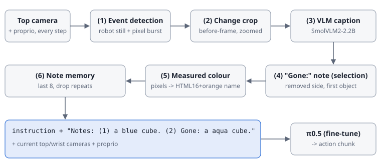

# 방법: 이벤트 기반 텍스트 노트



π0.5(LeRobot `pi05_base`)의 구조, 입력, 하이퍼파라미터는 그대로 둡니다. 메모리는 **정책이 읽는 지시문 문자열**로만 들어갑니다.

```
{instruction} Notes: (1) n1 (2) n2 ...
```

같은 파이프라인을 학습 demo와 온라인 평가에 똑같이 적용합니다.

| 용도 | 구현 위치 |
|---|---|
| 학습 데이터 생성 | `notes_vlm/build_ds.py` |
| 온라인 평가 | `lrbridge/server.py` |
| 공통 구현 | `notes_vlm/notes.py` |

## 1. 이벤트 감지: 언제 쓸까 (`notes.Scribe`, v2 이상)

아래 조건을 모두 만족하면 이벤트로 봅니다.

| 조건 | 값 |
|---|---|
| 직전 프레임 대비 변화가 δ보다 큰 픽셀 수 | N개 이상 (δ = `DPIX` = 40, N = `NPIX` = 8) |
| 위 픽셀 수가 직전 5 step 평균의 몇 배 이상인가 | ρ = `RATIO` = 4배 |
| 로봇 정지 | 직전 W = `IDLE` = 5 step 동안 전체 proprio 변화가 1e-3 미만 (엔드이펙터 위치·자세·그리퍼) |

- 정지 조건 덕분에 로봇이 스스로 움직여서 생긴 변화는 걸러집니다.
- 장면이 안정되면(변화가 작아지거나 5 step이 지나면) 한 번만 기록합니다.
- 과제 이름이나 라벨은 쓰지 않습니다.
- 평가 때 정책 출력의 아주 작은 떨림은 정지로 취급합니다(`DEADBAND=0.02`). demo에서와 같은 이벤트 구조를 얻기 위한 설정입니다.

## 2. 변화 영역 crop: 어디를 볼까 (`ChangeNoteWriter.main_region`, `zoom`)

- 바뀐 픽셀 중 가장 큰 연결 영역 주변을 정사각형으로 자르고, 384×384로 확대합니다(nearest).
- 128×128 카메라에서 3×3 픽셀인 큐브도 VLM이 알아볼 수 있게 됩니다.
- 로봇이나 테이블처럼 바뀌지 않은 부분은 crop에 들어가지 않습니다.

## 3. VLM 캡션 (`ChangeNoteWriter`, SmolVLM2-2.2B-Instruct)

- 바뀌기 **전** crop과 **후** crop을 따로 묻습니다. 두 장을 한 번에 넣으면 무엇이 나타났고 무엇이 사라졌는지를 자주 틀립니다.
- CROP 프롬프트: `List the objects in the image with precise color names, e.g. 'a cyan cube, a maroon cube'. The wooden surface is not an object. If there are no objects, answer 'nothing'.`
- t=0에는 전체 프레임으로 장면 노트를 한 번 씁니다.
- SCENE 프롬프트: `What objects are on the wooden table? Name each object with its color, e.g. 'a red cube'. Ignore the robot arm. If there is nothing on the table, answer 'The table is empty.'`

## 4. 선택: 무엇을 남길까 (`gone_note`, v4 이상)

- 새로 나타난 것은 계속 보이므로 저장하지 않습니다. **전 crop의 묘사만** `Gone: X.`로 남깁니다.
- X가 nothing이나 wooden surface이면 노트를 쓰지 않습니다.
- v3 노트(`Change: 전 -> 후`)는 후보 9색을 모두 나열해서 방해 정보가 됐습니다.

## 5. 표현: 어떻게 쓸까 (`measured_color`, `color_note`, v5/v6)

- 사라진 영역에서 채도 상위 25% 픽셀의 평균 RGB를 구합니다.
- 이 값을 가장 가까운 색 이름으로 바꿔 노트의 첫 색 단어를 교체합니다.
- 색 어휘는 v6에서 HTML 기본 16색 + orange(17개)이고, v5에서는 CSS4 148색이었습니다.
  - v5 어휘는 이름 사이 경계가 너무 촘촘했습니다. 그래서 같은 색이 학습 때와 온라인 렌더에서 다른 이름이 됐습니다(예: blue / mediumblue).
- v6는 첫 물체만 남깁니다. VLM이 큐브 하나를 윗면과 옆면 음영 때문에 두 물체로 적는 경우가 있기 때문입니다.

## 6. 활용: 정책 입력 (`NoteMemory`, `with_notes`)

- 노트는 쓴 순서대로 쌓입니다. 직전 노트와 같은 노트는 버리고, 최근 K = 8개만 붙입니다.
- 학습 데이터에서는 프레임마다 그 시점까지 쓰인 노트가 붙은 지시문을 task 문자열로 씁니다(LeRobot `task_index`).

## 버전 정리 (`NOTES_V`)

| 버전 | 쓰기 규칙 | 내용 | 비고 |
|---|---|---|---|
| v1 | 이벤트(정지 조건 약함) | SmolVLM2-500M 전체 프레임 캡션 | 초기 |
| v2 | Scribe | SmolVLM2-500M 전체 프레임 캡션 | 빈 테이블을 "monitor, keyboard"로 쓰는 환각 |
| v3 | Scribe | 2.2B, 변화 영역 crop, `Change: 전 -> 후` | 출현 노트가 방해 정보 |
| v4 | Scribe | v3에서 사라진 쪽만 (`Gone:`) | 선택 |
| v5 | Scribe | v4 + 측정 색 (CSS4) | 어휘가 너무 촘촘함 |
| **v6** | Scribe | v4 + 측정 색 (HTML16+orange), 첫 물체만 | **주력** |
| v7 | Scribe | v6에서 t=0 장면 노트 제거 | 활용 실험 |
| v8 | 50 step마다 | 전체 프레임 장면 캡션 (이벤트 감지·선택 없음) | **비교 방법: 주기적 캡션** |
| oracle | – | 정답 색 이름 직접 제공 | 상한 |
| vis / visfull | Scribe | 이벤트 때 crop(vis) 또는 전체 프레임(visfull)을 3×3 타일 이미지로 만들어 추가 카메라 입력 | **비교 방법: 시각 메모리** |

## 실제 노트 예시 (RC9-Long demo, 가공 없음)

단서가 aqua 큐브인 에피소드:

| step | v3 | v4 | v6 |
|---|---|---|---|
| 0 | a blue cube. | a blue cube. | a blue cube. |
| 101 (단서 사라짐) | Change: a cyan cube, a maroon cube -> brown. | Gone: a cyan cube, a maroon cube. | **Gone: a aqua cube.** |
| ~509 (후보 등장) | Change: a wooden surface -> a red cube, a green cube, … | (기록 안 함) | (기록 안 함) |

이 시점에 정책이 받는 v6 지시문:

```
Observe the cube's color, wait, then touch the cube of the same color. Notes: (1) a blue cube. (2) Gone: a aqua cube.
```

예시 이미지(프레임, 전후 crop)는 `docs/figures/rc9_example_*`에 있습니다. 파일 이름 규칙은 `{에피소드}_{순서}_{frame|cb(전 crop)|ca(후 crop)|after}`입니다.

다른 과제의 노트 예시와 해석은 보고서 `docs/report/index.html`의 "텍스트 노트는 실제로 이렇게 생겼습니다" 절에 있습니다.
